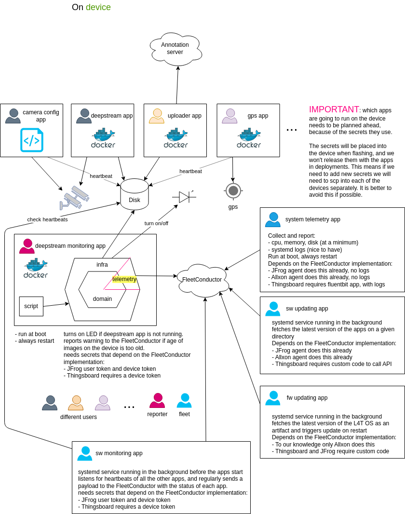
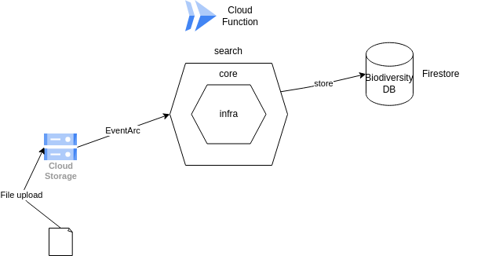
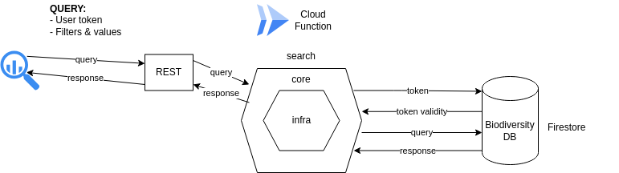

> Trifork's original README, moved here from the repository root on 2026-11-17. Links are
> relative to this folder. The current front door is [the root README](../../README.md).

# VD Biodiversity

This is the repository for the Biodiversity project from the Danish Vejdirektorat.

## Description

We want to support a fleet of devices that will be hosted in cars that are driving along Danish roads. 
These devices have 2 cameras installed. The rear camera is used to detect roadkills, and the side camera is used to detect plant types. We want to batch store the detections (gps coordinates + annotations + images) in a database, provide search functionality, and connect to the Dataudveksleren data exchange.

## Architecture

The device architecture with all the apps will be as follows:

Refer to [here](./applications.md) for detailed explanations on the apps running in the device and agreed formats between them.

The search upgrade module will be as follows:

The search query module will be as follows:

## Limitations
- The system does not work without GPS device providing the GPS coordinates. 
- Only one serial port usb device can be connected and it must be the GPS device. 

## Before shipping hardware

The [before-shipping](./before-shipping-hardware.md) guide contains a list of bulletpoints to check before delivering the hardware to ensure that the produc is ready to go.

Provide the [instructions-for-drive](./running-in-car.md) guide to the client.

## Flashing the Jetson

Currently the biodiversity project are using the jetsons xnx in production. Refer to [flash-jetson-xnx](./prepare-fresh-jetson-xnx.md) guide.

However, if we are using a jetson orin, refer to [flash-jetson-orin](./prepare-fresh-jetson-orin.md) for instructions on how to setup the project.

## Troubleshooting

#### How to check if an app is running?

Refer to [systemd](./troubleshooting/systemd.md) guide. Remember that the name of the apps are:

- deepstream
- deepstream-monitoring
- camera
- gps
- gcs
- monitoring

#### Cameras are not connected to the internet

Refer to [fix-camera-connectivity](./troubleshooting/fixing-camera-connectivity.md) guide.

#### Cameras are not working

Refer to [camera-orientation](./troubleshooting/testing-camera-orientation.md) guide.

#### GPS app is not working

Refer to [gps](./troubleshooting/gps.md) guide.

## Contributing

## Dev Setup to run main app

- `cd bio`
- Create `secrets` folder.
- Put the [necessary secrets](./secrets.md) there.
- `make build-dgpu`
- Reopen project in container.
- Make sure that there is a `bio/models/models-lock.json`
- `python3 -m utils.pull_models`
- Download the videos to the input path, specified in the `configs/config.yaml` or `configs/dev.yaml` —the second overrides the values of the first.
- Run with `python3 -m app.main`

**NOTE:** The `gcs` will also need a secrets folder with the json file to authenticate to google cloud storage.

## Other links

Documentation on general instructions regarding JFrog is stored in [`ai-core-tech-stack`](https://github.com/trifork/ai-core-tech-stack/blob/main/docs/JFrog-connect/jfrog-connect.md).

Documentation on how to train the models is stored in [here](docs/training.md) and also [here](docs/using-training-devcontainer.md).