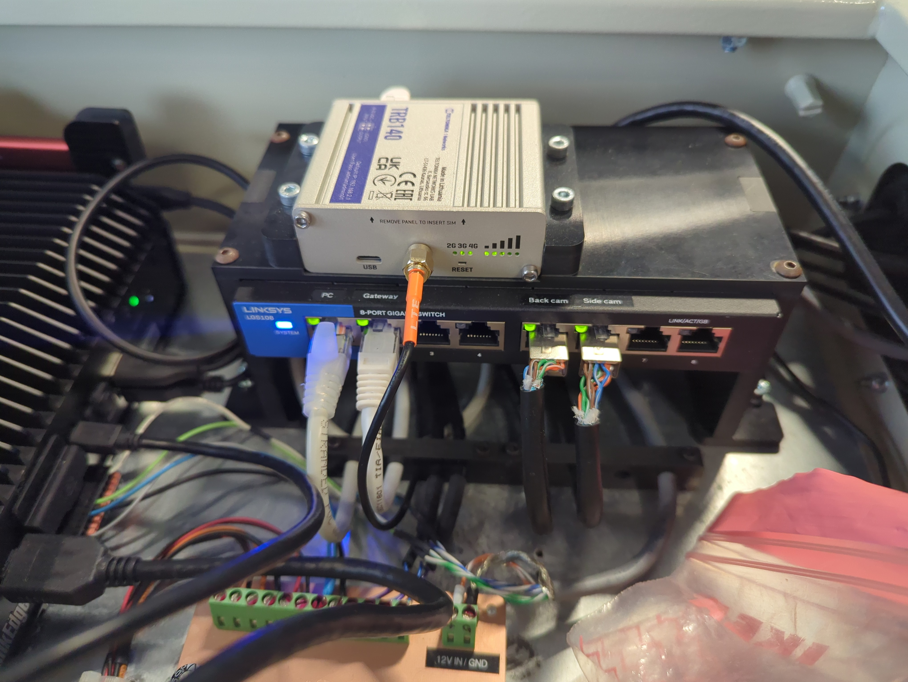
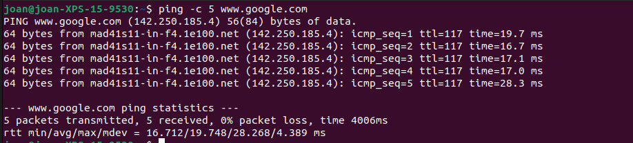

# Before shipping hardware

Here's a picture of a functional setup. This is how the hardware should look like.



## 0. Check the cameras are available

Check that the cameras are found and we can configure them using arv-tool-0.8 inside the docker container:

- Run the arv-tool script: `bash scripts/arv-tool.sh`. This will run arv-tool-0.8 internally, so it will print the name of the cameras that are available with their IPs.

- Create a yaml file in `bio/deploy/devices/<JETSON-ID>.yaml` that maps the camera names to the `REAR_CAMERA` and `SIDE_CAMERA` variables. This way we make sure we don't mix them. The file must contain the country associated to the `COUNTRY` variable.

## 1. Check the cameras output 

Refer to [camera-orientation](./troubleshooting/testing-camera-orientation.md) on how to verify the camera orientation.

## 2. Test that GPS is working.

If the Gps is working, there should be a file called `gps-data.json` in `/var/shared` folder.

## 3. Test that the 4G modem is working --- networking.

The light from the 4G modem should be green, like in the above picture.

Verify that the jetson has internet connection.

```
ping -c 5 www.google.com
```




## 4. Check that the LED is working.

We expect the green light when the power is ON, and we expect the yellow light when there is an error.


## 5. Verify hard drive
Check that the jetson's hardrive is well connected and verify the hard drive is properly mounted in the `/media/data` folder.

```
lsblk
```
The `/media/data` folder should be there.