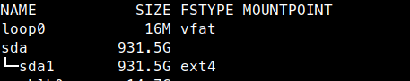
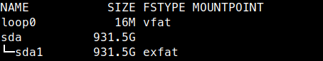
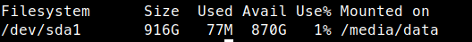

## Format disk partition as ext4, if needed

Before mounting the hard drive disk please check that the format is `ext4`:

```
lsblk -o NAME,SIZE,FSTYPE,MOUNTPOINT
```




If any other format is present, the disk partition needs to be formated:



Use the following command:

```
sudo mkfs.ext4 /dev/<PARTITION>
```

## Mounting Hard Drive disk

Based on [these instructions](https://confluence.jaytaala.com/display/TKB/Mount+drive+in+linux+and+set+auto-mount+at+boot)

1. Create folder where we will mount the disk

```
sudo mkdir -p /media/data
```

2. Find the disk's UUID:

To find the disk's uuid, you'll need to know the name of the hard disk:

```
lsblk
``` 

Loof for the name of the disk with a capacity of about 1 Tb. Find the disk's uuid with the following command:

```
ls -al /dev/disk/by-uuid/
```

3. Add the mount at boot time:

```
sudo vim /etc/fstab
```

Add the following line:
```
UUID=<UUID of our disk> /media/data   ext4    defaults        0       0
```

4. IMPORTANT! Before rebooting check that the `fstab` file is correct with:

```
findmnt --verify
```

We SHOULD NOT see any errors. Otherwise the device might become unbootable.

5. If everything was correct, reboot:

```
sudo reboot now
```

6. [**Optional**] Check free disk space after reboot. 

```
df -h /media/data
```

