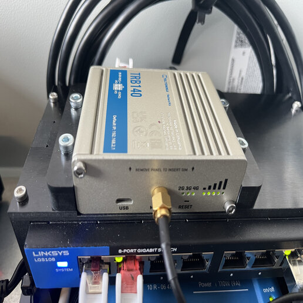

# Hardware setup on a new device

## Check that the hardware is present and well connected

There should be the following hardware elements

- GPS device connected to the jetson.
- Hard drive connected to the jetson.
- Two cameras.
- 4G modem.

## Insert the sim card 

Unscrew the panel from the front and unplug the cables from the back to insert the SIM card inside. 

