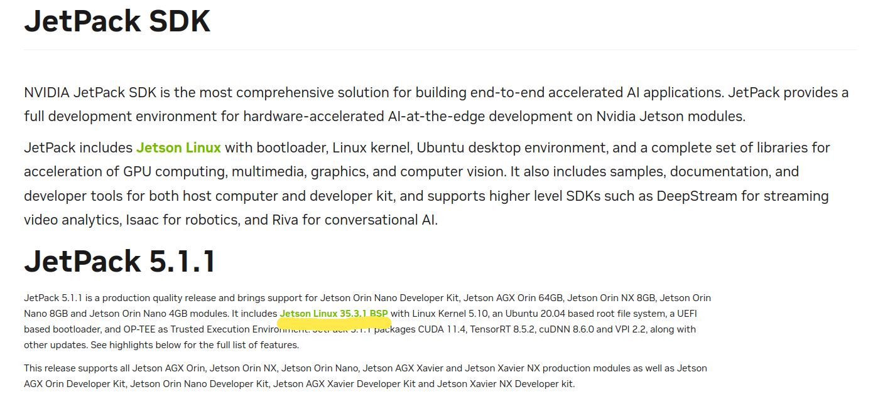
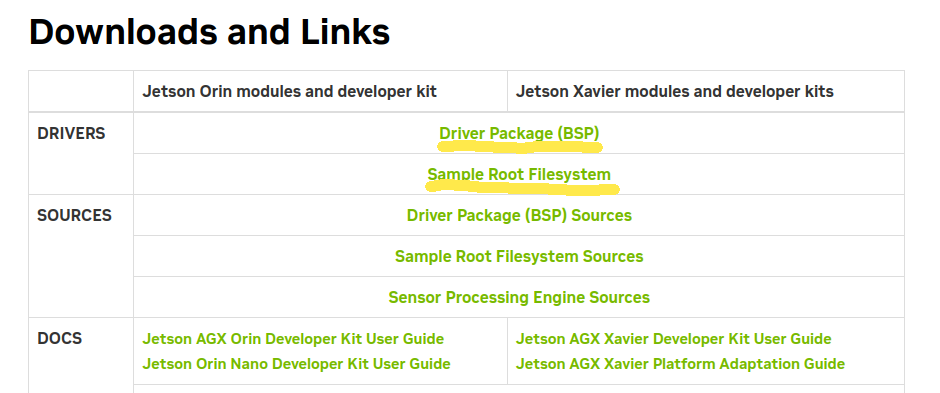
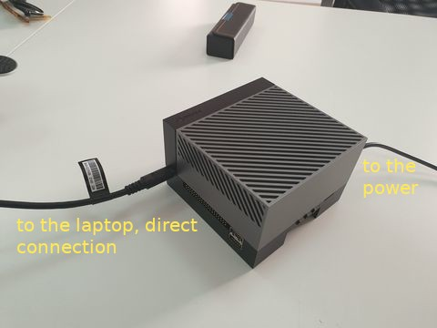
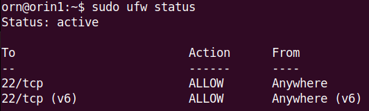

# Prepare fresh Jetson Orin

## Create dependencies folder for the jetson

Inside the dependencies folder, create `jetson` folder.

## Download the Jetson SDK

Go to the [Jetson SDK](https://developer.nvidia.com/embedded/jetpack) website. Currently the latest version of Linux is BSP 35.3.1, corresponding to JetPack 5.1.1. Go to the highlighted link:



In the new page, scroll down to the `Downloads and Links` section, and download the `Driver Package (BSP)` as well as the `Sample Root Filesystem` into the `dependencies/jetson` folder created in the previous step. They might require a login.



## Prepare the Jetson SDK for flashing

### Important
We need to run this from outside the container, in the root folder of the project.

### Requirements
Dependency required for this to work:
```
sudo apt-get install qemu-user-static
```

Create a `jetson-account.yaml` secret in the secrets folder with the following values:

```yaml
host: <HOST>
username: <USERNAME>
password: <PASSWORD>
```

These will be the values for the account that will be created on the Jetson. Please make sure that the `secrets` folder has the necessary secrets for the project.

Run the script:
```
bash scripts/prepare-jetson-sdk.sh
```

## Flash the SDK onto the Jetson

### Connect the Jetson to the laptop

Using a USB-C to USB-C cable, on the left while looking at the buttons, as seen in the image. Connection to the laptop needs to be direct, without any hubs.




### Setup the Jetson in recovery mode
The 3 buttons on the Jetson are, from the left to the right:

1. Power
2. Recovery mode
3. Reset

If you long-press the `Power` button for 5 seconds, it will shut down the Jetson. The light indicator should turn off.

Then, while pressing the `Recovery mode` button, turn it on by pressing the `Power` button. The light indicator should turn on.

To verify that Jetson is in recovery mode, from your laptop run:

```
lsusb
```

There should be an NVIDIA device whose ID is 7023 (for the Jetson Orin). If the ID is different, then it means it's not in recovery mode. This is a correct example of what you should see:


### Set the correct flash target
In the script scripts/flash-jetson-sdk.sh set the correct target for flashing. Consolidate the link https://docs.nvidia.com/jetson/archives/r35.3.1/DeveloperGuide/text/IN/QuickStart.html#jetson-modules-and-configurations

For ORIN AGX 64gb set 'jetson-agx-orin-devkit'

For ORIN NX 16gb set 'jetson-orin-nano-devkit'


### Flash the Jetson

```
bash scripts/flash-jetson-sdk.sh
```

# After successful flash...


After a successful flash, we will need to connect to it using the mini-USB port, because ssh is not enabled by default.

The device for the serial console is called `ttyACM0`.

```
sudo screen /dev/ttyACM0 115200
```

<em>If you want to <strong>exit</strong> the screen session, run the following command in another terminal: `sudo screen -list`. It will return the active screen sessions where you can get a response like `65627.<machine> (02/05/23 10:15:31) (Attached)` and you can kill this screen by running the command `sudo screen -S 65627 -X quit`.</em>

## Connect to WIFI

```
sudo nmcli dev wifi connect <WIFI_SSID> --ask
```

## Enable ssh
```
sudo apt-get update
sudo apt-get install ufw
sudo ufw enable
sudo ufw allow ssh
```
### Error handling
- In case the `apt update` is not working, it is probably because another proccess is using it in the background. If the following steps to correct the timezone didn't work, waiting for a couple of minutes seems to be working so far. 

- In case there are issuses with the ufw enable, you can check it with `sudo ufw status`. After completing the steps the resut should be:

    


## Setup correct timezone and time
If we don't have the correct time setup, we will find issues when trying to run `apt` commands, as https handshake will fail due to the wrong time.


### 1. Configure the right timezone
This will open up an interactive console where we can select the region and city with the right timezone.
    
```
sudo dpkg-reconfigure tzdata
```

### 2. Install ntp to sync the time
```
sudo apt install ntp
```

### 3. Test that apt update works
```
sudo apt-get update
```

## Connect through ssh

### 1. Check the IP
Option 1: Run the following command from the `screen` session, while connected to the mini-USB port on the Jetson. Look into the last paragraph of the output and the IP is shown after `inet`.
```
ifconfig
```

Option 2: If you are in the <strong>same local network</strong> as the machine run (in this example orin1 is the name of the machine) and it will inform you about the IP.
```
ping orin1.local
```
### 2. SSH into it
Once we know the IP we can connect to it through SSH, which is nicer to use.
```
ssh -o IdentitiesOnly=yes orn@<IP>
```
## Run setup script

```
sudo jetson_user=<USERNAME> bash /opt/scripts/setup.sh
```