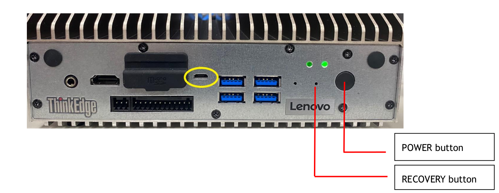
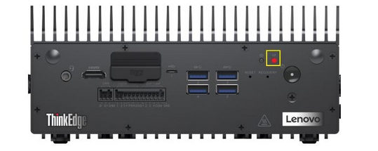
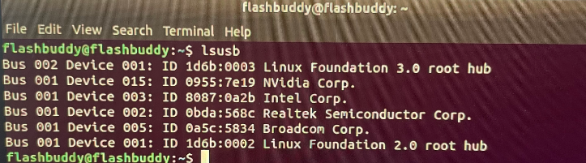

# Prepare fresh jetson xnx

## First steps

- Check [hardware-setup](./new-device-hardware-setup.md) guide to setup the hardware on a new device properly.

- Prepare the following material for flashing:
    - flashbuddy
    - needle
    - monitor
    - HDMI cable
    - Keyboard
    - mouse

## Create a dependencies folder

Inside the dependencies folder create a `jetson` folder.

## Download the jetson SDK

Download the Jetson SDK [here](https://download.lenovo.com/km/media/attachment/SE70_generic_preload_20230922.tgz) into de `dependencies/jetson` folder created in the previous step.

## Flash the device 

#### Setup the jetson into force recovery mode 

Make sure that the jetson is turned off before following the next steps:

1. Press and hold the RECOVERY button, you'll need a needle or a pen to press it.
2. Press and hold the POWER button.
3. Release the POWER button.
4. Release the RECOVERY button.
5. Connect the device to the laptop with Micro-USB to USB cable.

**Important**: A USB to Micro-USB cable connects the correct Micro-USB port on SE70 to the host computer
to be used for flashing.



To verify that the jetson is in recovery mode, the Led light should be turned red.



If you check with the `lsusb` command that the jetson is in recovery mode, the code displayed will not be `7023`.



#### Flash the jetson

```
sudo bash scripts/flash-jetson-xnx.sh
```

**NOTE**: If the flash is not successful, turn the jetson off, set it into force recovery mode and flash it again. 

**NOTE**: You may need to do this procedure multiple times. If you're not able to flash the device it contact develco support.


# After successful flash...

After a successfuul flash, the jetson will automatically be shutdown. Press the power botton again, it may take a few minutes (wait until the LED turns green).

Connect a monitor to the jetson with an HDMI cable, some manual configurations needs to be done:

- Accept license agreement.
- Configure Power mode. You can use the default, as it can be changed later.
- Configure language options. US keyboard with English as default language is preferred.
- Configure Timezone as Central.
- Configure the username, hostname and password. These are the preferred values:
    - `username`: `xnx`
    - `hostname`: `bluemar-bio-xnx-<ID>`
    - `password`: ask Trifork
- Set the maximum parition size, the default is already the maximum partition size.
- Do not install any web browser, it is not needed.

After a manual configuration, we can connect to it using the mini-USB port.

```
sudo screen /dev/ttyACM0 115200
```

<em>If you want to <strong>exit</strong> the screen session, run the following command in another terminal: `sudo screen -list`. It will return the active screen sessions where you can get a response like `65627.<machine> (02/05/23 10:15:31) (Attached)` and you can kill this screen by running the command `sudo screen -S 65627 -X quit`.</em>

## Mount the hard drive disk

The hard drive disk needs to be mounted into the `media/data` folder. Follow the instructions in [here](./mounting-disk.md).

## Run the setup script
1. Create tar file with the setup scripts and the secrets
    ```
    cd bio/ && make tar-setup
    ```

2. Copy the tar file into the home directory of the jetson
    ```
    scp setup.tar.gz xnx@xnx1.local:~/
    ```

3. Extract the files on the jetson. The expected files are: `setup-xnx.sh`, `install-deps.sh` and a folder named `secrets` with `bot.env`, `tailscale.txt` and `nordfou-biodiversity-2cd0fb3af162.json` files.
    ```
    tar xzvf setup.tar.gz
    ```

4. Run the setup script on the jetson.
    ```
    sudo bash setup-xnx.sh ~/secrets xnx
    ```

## Device configuration

After the setup is complete, we need to create the device configuration in `/opt/apps/deepstream/devices`. It consists of a `yaml` file with the same name as the hostname and with the following fields:

```
COUNTRY:
REAR_CAMERA:
SIDE_CAMERA:
```

This process must be done manually because we need to figure out which camera name corresponds to the `REAR_CAMERA` and which to the `SIDE_CAMERA`. 

Record a video on both cameras following the guide in [here](./troubleshooting/testing-camera-orientation.md) and check which video corresponds to the `SIDE_CAMERA` and `REAR_CAMERA` so that you can complete the `yaml` file.

After the file is created, change the ownership of the file `root:apps` with the command: `sudo chown root:apps bluemar-bio-xnx-<ID>.yaml`.

**NOTE**: The `REAR_CAMERA` is the roadkill camera whereas the `SIDE_CAMERA` is the plant camera.